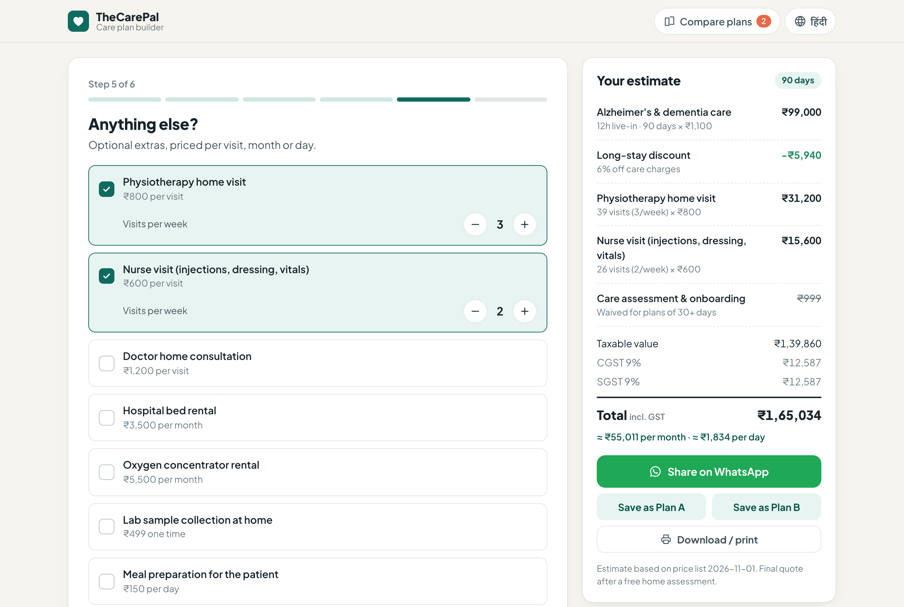
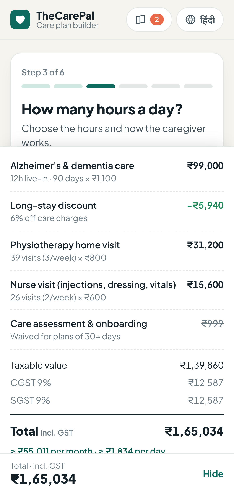
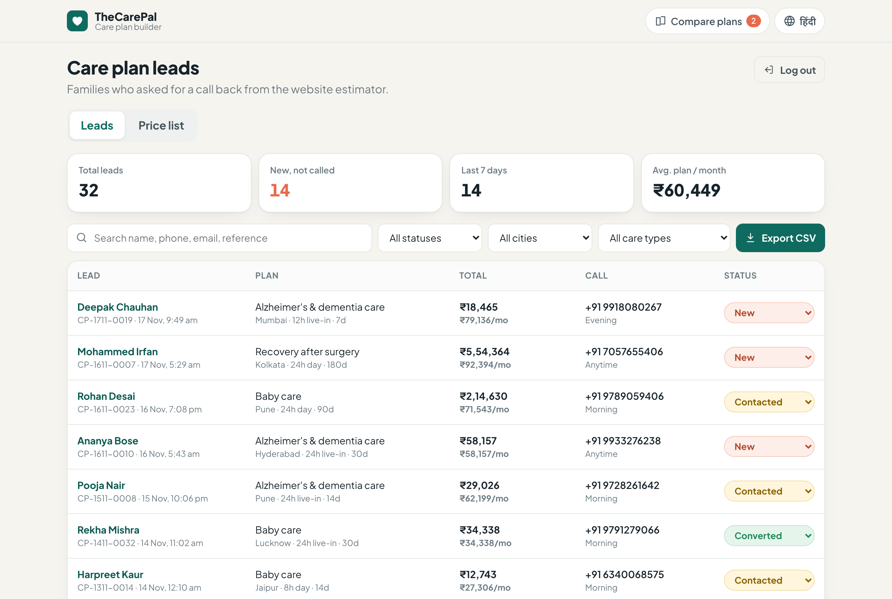
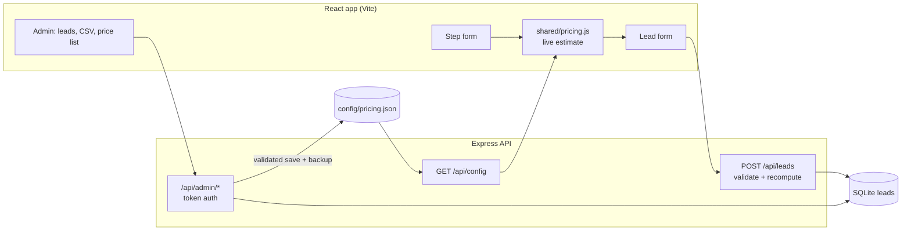

# CarePal Care Plan Builder & Price Estimator

A self-serve estimator for home care in India. A family picks who needs care,
the city, hours, shift type, duration and add-ons, sees a **live, line-by-line
price with GST**, and asks for a call back. The operations team gets an admin
page with every lead, a CSV export and an editor for the price list.

Built for TheCarePal assignment **FS-01** with React (Vite), Node.js (Express) and SQLite.

> **Demo video (4 min):** https://drive.google.com/file/d/1cJzHq0bJzmGpIhIeA078rPp9REwoshzH/view?usp=sharing
> **Stack:** React 19 · Vite · Express 5 · SQLite (`node:sqlite`) · plain CSS · `node:test`

| Builder with live estimate | Phone (360px) | Admin |
|---|---|---|
|  |  |  |

---

## What it does

### Must-haves

| Requirement | Where |
|---|---|
| Step-by-step form: care type, city, 8/12/24 hours, live-in or day shift, duration, add-ons | `web/src/components/steps.jsx`, `web/src/pages/Estimator.jsx` |
| Prices from a JSON config (per city, service and shift), not hard-coded | `config/pricing.json`, served by `GET /api/config` |
| Live estimate with line-by-line breakdown incl. GST (CGST + SGST) | `shared/pricing.js`, `web/src/components/EstimateBreakdown.jsx` |
| Lead capture (name, phone, email, preferred call time) saved to the backend with validation | `web/src/components/LeadForm.jsx`, `POST /api/leads`, `shared/lead.js` |
| Admin page behind a login: leads with their plan, CSV export | `/admin`, `server/src/routes/admin.js` |
| Works on a 360px phone | mobile-first CSS, sticky total bar that opens the breakdown |

### Good-to-haves (all three done)

- **Compare two plans side by side** with the monthly difference and changed rows highlighted (`/compare`)
- **Share on WhatsApp** with a summary and a link that reopens the exact plan
- **Hindi toggle** for the whole family-facing UI, including service names from the config

### Extras I added because a real team would need them

- **Price list editor** in the admin page, so ops can change rates without touching JSON. Every save is validated, backed up and goes live without a deploy.
- **Server recomputes every price**; a tampered browser request cannot store a fake total.
- **Config validation** on startup and on save (missing rates, negative prices, bad ids, GST split).
- Lead **status pipeline** (new → contacted → converted / lost), ops notes, one-tap Call / WhatsApp / Email.
- Long-stay **discounts**, onboarding fee **waiver** for 30+ day plans, per-day and per-month equivalents.
- **Spam protection** (honeypot + rate limit), signed admin tokens, constant-time password check.
- **Excel-safe CSV** (UTF-8 BOM for Hindi names, formula-injection guard).
- Plan and progress saved in the browser, **print / save as PDF** layout, keyboard and screen reader friendly controls.
- **23 automated tests** and a GitHub Actions workflow that runs them and builds the app.

More screenshots: [home](docs/screenshots/01-home.png) · [phone step](docs/screenshots/03-mobile-step.png) · [Hindi](docs/screenshots/09-mobile-hindi.png) · [compare](docs/screenshots/05-compare.png) · [lead detail](docs/screenshots/07-admin-lead-detail.png) · [price list editor](docs/screenshots/08-admin-price-list.png)

---

## Run it locally

Needs **Node.js 22.13+** (it uses the built-in `node:sqlite`, so there is no database to install).

```bash
git clone https://github.com/amartya1523/carepal-care-plan-estimator.git
cd carepal-care-plan-estimator

npm run install:all          # installs server/ and web/
cp .env.example .env         # then set ADMIN_PASSWORD and SESSION_SECRET
npm run seed                 # 32 synthetic leads so the admin page has data
```

**Development** (two terminals, hot reload):

```bash
npm run dev:api              # API on http://localhost:4000
npm run dev:web              # app on http://localhost:5173 (proxies /api)
```

**Production-like** (one process, Express serves the built app):

```bash
npm run build && npm start   # http://localhost:4000
```

- Estimator: `/` · Compare: `/compare` · Admin: `/admin` (username and password from `.env`)
- Tests: `npm test`
- Reset demo data: `npm run seed -- --reset`

---

## How it works



```
config/pricing.json      price list: cities x services x shifts, add-ons, GST, discounts, fees
shared/                  code used by BOTH the browser and the server
  pricing.js             plan -> estimate (pure functions)
  config-schema.js       validates the price list
  lead.js                lead validation, Indian mobile normalisation
server/src/
  app.js                 express app factory (used by tests too)
  routes/public.js       /api/config, /api/estimate, /api/leads
  routes/admin.js        login, leads list/update, CSV, price list read/save
  db.js                  SQLite schema + lead repository
  pricing-store.js       loads, validates, atomically saves and backs up the config
  auth.js, rate-limit.js, csv.js, lead-export.js
server/scripts/seed.js   synthetic demo leads
web/src/
  pages/                 Estimator, Compare, Admin
  components/            steps, estimate panel, lead form, admin tabs
  lib/                   i18n (en/hi), plan state, config loader, API client
```

### The price list

```jsonc
{
  "gst": { "rate": 0.18, "split": { "cgst": 0.09, "sgst": 0.09 } },
  "cities": [
    { "id": "pune", "label": { "en": "Pune", "hi": "पुणे" },
      "rates": {
        "elderly": {
          "day":     { "8": 850, "12": 1100, "24": 2000 },   // ₹ per day
          "live_in": { "12": 900, "24": 1150 }               // no "8" = not offered
        } } }
  ],
  "addOns": [
    { "id": "physio", "unit": "visit", "price": 800,
      "frequency": { "min": 1, "max": 7, "default": 3 },
      "appliesTo": ["elderly", "dementia", "post_surgery"] }
  ],
  "longStayDiscounts": [ { "minDays": 30, "rate": 0.03 }, { "minDays": 90, "rate": 0.06 } ],
  "oneTimeFees": [ { "id": "onboarding", "amount": 999, "waivedFromDays": 30 } ]
}
```

To change a price: edit the number (or use **Admin → Price list**). To add a city:
add an object to `cities`. Labels carry `en` and `hi` so translations live with the data.

### How an estimate is calculated

1. **Care**: day rate for city × care type × shift × hours, times the number of days.
2. **Long-stay discount** on care charges (3% from 30 days, 6% from 90, 10% from 180).
3. **Add-ons**, by unit: visits per week over the duration, per month (rounded up), per day, or once.
4. **One-time fees**, waived when the plan is long enough.
5. **GST**: CGST 9% + SGST 9% on the taxable value. All money is whole rupees, rounded once per line, so the breakdown always adds up to the total.

### API

| Method | Path | Auth | What |
|---|---|---|---|
| GET | `/api/config` | – | current price list |
| POST | `/api/estimate` | – | `{ plan }` → estimate (422 with field errors if invalid) |
| POST | `/api/leads` | – | `{ plan, lead, language }` → `{ reference, estimate }` (rate limited) |
| POST | `/api/admin/login` | – | `{ username, password }` → `{ token }` |
| GET | `/api/admin/leads` | Bearer | `?status&city&service&q` → leads + stats |
| GET | `/api/admin/leads.csv` | Bearer | same filters, CSV download |
| PATCH | `/api/admin/leads/:id` | Bearer | `{ status?, adminNote? }` |
| GET / PUT | `/api/admin/pricing` | Bearer | read / validate + save the price list |

Design decisions and assumptions are explained in more detail in **[docs/DECISIONS.md](docs/DECISIONS.md)**.

---

## Testing

```bash
npm test
```

- `shared/test/pricing.test.js`: rates by city/service/shift, discount and fee waiver thresholds, add-on quantities, "breakdown always adds up", invalid combinations, config validator.
- `shared/test/lead.test.js`: phone normalisation, field errors, Hindi names.
- `server/test/api.test.js`: boots the real Express app on a random port with an in-memory DB and checks lead capture, server-side recompute, admin auth, status updates, CSV (BOM + formula guard) and price list save/reject.

CI runs the tests and the production build on every push.

## Security and data

- No secrets in the repo: `.env` is git-ignored, `.env.example` documents every variable.
- The admin login is disabled until `ADMIN_PASSWORD` and `SESSION_SECRET` are set.
- All demo data is synthetic (made-up names, `example.com` emails). No real patient data.

## What I would build next

1. **Move to TheCarePal's stack**: Firebase Auth for ops logins (roles: ops, manager), Firestore for leads, a Cloud Function for `POST /leads` that reuses `shared/pricing.js` unchanged.
2. **Price list history and approvals**: diff view between versions, "maker-checker" so a second person approves rate changes, scheduled price changes.
3. **Lead follow-up**: auto-assign leads to a care manager by city, WhatsApp Business template on submit, SLA timer for "new, not called".
4. **OTP verification** of the phone number before a lead is saved, to cut fake leads.
5. **Analytics**: drop-off per step, most-chosen plans per city, conversion by care type.
6. **Better quotes**: weekday/weekend and festival surcharges, multiple patients at one address, PDF quote with the company letterhead.
7. More languages (Marathi, Tamil, Bengali) since labels are already data-driven.

## AI tools used

- **AI coding assistant** (chat-based LLM): for scaffolding boilerplate, a first
  pass of the CSS, drafting tests and Hindi translations, and reviewing my code
  for edge cases. I reviewed and adjusted every part and can explain all of it;
  the pricing model, data shapes and product decisions are mine.
- **ElevenLabs** text-to-speech: voiceover for the demo video.

## License

MIT
